# Business Suite database

All data for the staff apps **Owner, Sales, Customers, Policies, Staff, Money and Settings** is stored in
PostgreSQL in its own schema, `business` (53 tables). The existing Team Desk tables (tickets, calendar,
attendance check-ins) are unchanged.

- Schema (single source of truth): [`backend/askus-api/src/business/schema.ts`](../backend/askus-api/src/business/schema.ts)
- Production migration: [`1795900000000-AddBusinessSuite.ts`](../backend/askus-api/src/migrations/1795900000000-AddBusinessSuite.ts)
- API mapping, validation and permissions: [`registry.ts`](../backend/askus-api/src/business/registry.ts), [`business.service.ts`](../backend/askus-api/src/business/business.service.ts)

## Design rules

| Rule | How it is enforced |
|---|---|
| Every row has a stable id | `id uuid` primary key (`gen_random_uuid()`) |
| Audit basics | `created_at`, `updated_at` (trigger keeps it current), `created_by` → `identity.users` |
| Relationships | Real foreign keys (137). Lookups use `ON DELETE RESTRICT`, so a product, branch or staff member in use cannot be deleted; child rows (e.g. an enquiry's quotes) cascade |
| No duplicates | `UNIQUE` on codes and natural keys: staff code, enquiry no., quote no., receipt no., one attendance row per person per day, one payslip per person per month, one daily report per person per day |
| Valid values | `CHECK` rules (120): allowed statuses, rating 1–5, end date ≥ start date, money ≥ 0, cash entry is either in or out, masked bank account numbers, valid IFSC |
| Money | `numeric(14,2)`; percentages `numeric(5,2)` |
| Calculated by the database | Quote GST (18 %) and insurer commission are generated columns |
| Approvals | Leave, permissions, field visits, expense claims, discounts and daily reports record `decided_by` and `decided_at`; only admins can approve or reject |
| Speed | Indexes on every foreign key and date/status column the screens filter by |

## Tables and relationships

```mermaid
erDiagram
  branches ||--o{ employees : "works at"
  departments ||--o{ employees : "in"
  designations ||--o{ employees : "job title"
  employees ||--o{ employees : "reports to"
  employees |o--o| branches : "manages"

  customers ||--o{ leads : "may become"
  products ||--o{ leads : "interested in"
  lead_sources ||--o{ leads : "came from"
  lead_stages ||--o{ leads : "stage"
  employees ||--o{ leads : "assigned to"
  leads ||--o{ lead_products : "products quoted"
  leads ||--o{ quotes : "quotes"
  leads ||--o{ sales_tasks : "to-dos"
  leads ||--o{ calls : "calls"
  customers ||--o{ calls : "service calls"
  call_outcomes ||--o{ calls : "result"
  leads ||--o{ discount_requests : "discounts"
  leads ||--o{ care_assignments : "handed to service"
  employees ||--o{ daily_reports : "daily report"

  customers ||--o{ renewals : "policies to renew"
  customers ||--o{ feedback : "ratings"
  customers ||--o{ complaints : "complaints"
  insurers ||--o{ renewals : "insurer"

  projects ||--o{ project_tasks : "tasks"
  projects ||--o{ time_logs : "hours"
  employees ||--o{ time_logs : "logged by"
  products ||--o{ proposals : "new policy"

  employees ||--o{ attendance : "days"
  employees ||--o{ leave_requests : "leave"
  leave_types ||--o{ leave_requests : "type"
  employees ||--o{ permission_requests : "permissions"
  employees ||--o{ field_visits : "field visits"
  employees ||--o{ expense_claims : "expenses"
  expense_categories ||--o{ expense_claims : "category"
  employees ||--o{ payslips : "salary"
  job_openings ||--o{ applicants : "applicants"
  applicants ||--o{ interviews : "interviews"
  cleaning_tasks ||--o{ cleaning_log : "done"
  facility_types ||--o{ repairs : "repairs"
  asset_categories ||--o{ assets : "assets"
  employees ||--o{ assets : "holds"

  insurers ||--o{ commissions : "pays"
  employees ||--o{ receipts : "collected"
```

| App | Tables |
|---|---|
| Settings | `branches`, `departments`, `designations`, `products`, `insurers`, `lead_sources`, `lead_stages`, `call_outcomes`, `leave_types`, `expense_categories`, `asset_categories`, `facility_types`, `cleaning_tasks`, `holidays`, `settings` (leave, permission and office-timing rules) |
| Sales | `leads`, `lead_products`, `sales_tasks`, `calls`, `quotes`, `discount_requests`, `daily_reports` (team = sales), `care_assignments` |
| Customers | `customers`, `renewals`, `feedback`, `complaints`, `calls`, `daily_reports` (team = care) |
| Policies | `proposals`, `policy_changes`, `projects`, `project_tasks`, `time_logs` |
| Staff | `employees`, `attendance`, `leave_requests`, `permission_requests`, `field_visits`, `expense_claims`, `payslips`, `job_openings`, `applicants`, `interviews`, `notices`, `visitors`, `cleaning_log`, `repairs`, `assets` |
| Money | `receipts`, `payments`, `invoices`, `commissions`, `cash_entries`, `bank_accounts` |

## API

One endpoint per list, all requiring a signed-in staff user (`/api/business` lists them all):

| Method | Path | Purpose |
|---|---|---|
| GET | `/api/business/:list` | Rows the caller may see. Links come back as a readable name plus the id, e.g. `assignedTo` and `assignedToId` |
| POST | `/api/business/:list` | Create. Links may be sent as an id (preferred) or a name, which is checked against the linked table |
| PATCH | `/api/business/:list/:id` | Change some fields |
| DELETE | `/api/business/:list/:id` | Remove (refused if other records depend on it) |

Access levels: **staff** (any employee or agent), **payments** (Money users and admins), **admin**.
Staff salaries and dates of birth are hidden from non-admins.

## Running it

- **Development:** the API creates the schema on start-up and, if it is empty, loads sample data (about 1,100 rows).
  Set `BUSINESS_DEMO_SEED=false` to start empty.
- **Production:** run `npm run migration:run` in `backend/askus-api`; nothing is created or seeded automatically.
- **Web app:** with `NEXT_PUBLIC_API_BASE_URL` set, the apps read and write through the API. Without it they
  fall back to browser-only demo storage.
